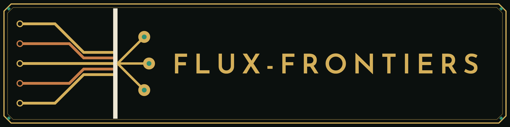

<p align="center">
  
</p>

<p align="center">
  <em>One registry. Many KGs. Infinite domains.</em>
</p>

<p align="center">
  
  <a href="https://www.elastic.co/licensing/elastic-license"></a>
  
</p>

---

## What We Build

Flux Frontiers is a research and engineering organization focused on **deterministic knowledge-graph retrieval** — turning formally structured artifacts (source code, documents, biochemical pathways, legal statutes, protein structures, personal diaries) into queryable knowledge graphs that AI agents can reason over without hallucination.

Our central conviction: **structure is ground truth**. When an ontology is well-defined — Python's AST, KEGG reaction schemas, PDB file format, statute hierarchies — a knowledge graph derived from it carries the same guarantees as the source itself. Semantics then *accelerate* retrieval; they do not replace correctness.

We build the full stack: individual domain KG libraries, a federated orchestration platform, and MCP server integrations that expose every graph as native tool calls to AI agents.

---

## The Stack

Every repository below is public. Packages marked with a PyPI name install with `pip`; the rest install from GitHub.

### Federation and SDK

| Repository | PyPI | Description |
|---|---|---|
| [**KGRAG**](https://github.com/Flux-Frontiers/KGRAG) | [`kg-rag`](https://pypi.org/project/kg-rag/) | The federation layer. Registers every domain KG, fans a query out across all of them, and returns one globally ranked result set. Ships as a CLI and an MCP server. |
| [**kgmodule-utils**](https://github.com/Flux-Frontiers/KG_utils) | [`kgmodule-utils`](https://pypi.org/project/kgmodule-utils/) | Shared SDK for every KG module: graph store, sqlite-vec semantic index, build pipeline, snapshots, and the 3-D growth engine behind the fleet's visualizations. |

### Domain knowledge graphs

| Repository | Kind | PyPI | Description |
|---|---|---|---|
| [**PyCodeKG**](https://github.com/Flux-Frontiers/pycode_kg) | `code` | [`pycode-kg`](https://pypi.org/project/pycode-kg/) | Python codebase analysis via AST: complete call graph, class hierarchies, import chains, and docstring embeddings. Structural truth + semantic retrieval. |
| [**TSCodeKG**](https://github.com/Flux-Frontiers/tscode_kg) | `typescript` | [`tscode-kg`](https://pypi.org/project/tscode-kg/) | The same code graph for TypeScript and JavaScript, built with tree-sitter. |
| [**SwiftKG**](https://github.com/Flux-Frontiers/swift_kg) | `swift` | [`swift-kg`](https://pypi.org/project/swift-kg/) | The same code graph for Swift codebases, built with tree-sitter. |
| [**DocKG**](https://github.com/Flux-Frontiers/doc_kg) | `doc` | [`doc-kg`](https://pypi.org/project/doc-kg/) | Semantic knowledge graph for document corpora: Markdown, plain text, RST, and PDF. Extracts sections, topics, entities, and cross-references. |
| [**VaultKG**](https://github.com/Flux-Frontiers/vault_kg) | `vault` | [`vault-kg`](https://pypi.org/project/vault-kg/) | Obsidian-style Markdown vaults as a knowledge graph: notes, folders, wikilinks, and backlinks. |
| [**DiaryKG**](https://github.com/Flux-Frontiers/diary_kg) | `diary` | [`diary-kg`](https://pypi.org/project/diary-kg/) | Personal diary corpus as a temporally ordered knowledge graph. Chronological narrative + semantic search. |
| [**MemoryKG**](https://github.com/Flux-Frontiers/memory_kg) | `memory` | [`memory-kg`](https://pypi.org/project/memory-kg/) | Episodic memory traces: personal recollections structured as an associative knowledge graph. |
| [**AgentKG**](https://github.com/Flux-Frontiers/agent_kg) | `agent` | [`agent-kg`](https://pypi.org/project/agent-kg/) | Conversational memory as a live knowledge graph. Persists agent session context across turns; queryable by topic and entity. |
| [**FTreeKG**](https://github.com/Flux-Frontiers/ftree_kg) | `filetree` | [`ftree-kg`](https://pypi.org/project/ftree-kg/) | File system tree knowledge graph: directory hierarchies, file metadata, and image EXIF data. |
| [**GenealogyKG**](https://github.com/Flux-Frontiers/genealogy_kg) | `genealogy` | [`genealogy-kg`](https://pypi.org/project/genealogy-kg/) | GEDCOM family-history files as a knowledge graph: people, families, events, and places, with lineage walks and a living-person privacy filter. |
| [**GutenbergKG**](https://github.com/Flux-Frontiers/gutenberg_kg) | `gutenberg` | GitHub | GutenbergKG - the Knowledge Press. 245 Books, 1.2m Nodes, 5.4m Edges |
| [**MetaboKG**](https://github.com/Flux-Frontiers/metabo_kg) | `meta` | GitHub | Metabolic pathway knowledge graph backed by KEGG/BioCyc reaction schemas. Supports FBA, ODE simulation, and what-if perturbation analysis. |
| [**ConnectomeKG**](https://github.com/Flux-Frontiers/connectome_kg) | `connectome` | [`connectome-kg`](https://pypi.org/project/connectome-kg/) | The FlyWire FAFB v783 *Drosophila* connectome as a knowledge graph: 139,255 neurons and 3.7 million synaptic pairs, with path and cone queries between cell types. |

### Corpora

| Repository | Description |
|---|---|
| [**The Diary of Samuel Pepys**](https://github.com/Flux-Frontiers/corpus_pepys) | Pepys's complete diary (1660-1669) as an interactive semantic knowledge graph, built on DiaryKG. |

### The Knowledge Press

Ways to read a knowledge graph by walking through it: each edition draws its data as trees you drive among in 3-D, in the browser.

| Edition | Website | Description |
|---|---|---|
| [**The Forest**](https://github.com/Flux-Frontiers/knowledge_press) | [Open the Forest](https://flux-frontiers.github.io/knowledge_press/) | A GutenbergKG corpus of public-domain books, every book grown as a tree. Also an iPhone, iPad and Mac app that searches the corpus on the device. |
| **The Family** | Coming soon | A GenealogyKG family tree: each line of descent grown as a tree, families as groves, the home person's line gilded. |
| [**The Disulfides**](https://github.com/Flux-Frontiers/kpress_disulfide) | [Open the orchard](https://flux-frontiers.github.io/kpress_disulfide/) | The proteusPy disulfide database: every disulfide bond in the Protein Data Bank, 158,965 in the published set, classified by its five torsions, each binary class grown as a tree in groves by family. |

### Holographic visualization

| Repository | PyPI | Description |
|---|---|---|
| [**Quiltwright**](https://github.com/Flux-Frontiers/quiltwright) | [`quiltwright`](https://pypi.org/project/quiltwright/) | Holographic output for scientific visualization: renders a 3-D scene as a light-field quilt and casts it to a Looking Glass display. |
| [**pypdb2pov**](https://github.com/Flux-Frontiers/pypdb2pov) | [`pypdb2pov`](https://pypi.org/project/pypdb2pov/) | Converts PDB and mmCIF protein structures into POV-Ray scenes. |

### Scientific computing

| Repository | PyPI | Description |
|---|---|---|
| [**ProteusPy**](https://github.com/suchanek/proteusPy) | [`proteusPy`](https://pypi.org/project/proteusPy/) | Python library for protein structure analysis: disulfide bond geometry, PDB parsing, torsion angle calculation, visualization. Used in structural bioinformatics research. |
| [**WaveRider**](https://github.com/Flux-Frontiers/waverider) | [`waverider`](https://pypi.org/project/waverider/) | Riemannian manifold ML stack: zero-parameter classifiers, geometric gradient descent, and intrinsic dimensionality probes for high-dimensional embedding spaces. |
| [**turtlend**](https://github.com/Flux-Frontiers/turtlend) | [`turtlend`](https://pypi.org/project/turtlend/) | A turtle that carries its own orthonormal frame through 3- or N-dimensional space: `TurtleND`, `Turtle3D`, and `Vector3D`. |

---

## How It Works

All domain KG libraries implement a common `KGAdapter` protocol — a clean three-method interface (`query`, `pack`, `stats`). Our federation platform uses this contract to fan queries out across every registered graph simultaneously, globally rank the results, and return a unified answer set with full source provenance:

```
User Query: "glucose transport mechanism"
    │
    ├──▶ PyCodeKG  (analysis codebase)   → 3 functions, 1 class
    ├──▶ DocKG     (research papers)     → 4 document sections
    └──▶ MetaboKG  (metabolic pathways)  → 2 pathway nodes, 5 reactions
                               │
                    ┌──────────▼──────────────┐
                    │  Globally Ranked Results │
                    │  (unified relevance)     │
                    └─────────────────────────┘
```

MCP integration means any AI agent — Claude, GitHub Copilot, Cursor, or a custom agent — can make federated queries as native tool calls. The knowledge graph becomes part of the agent's cognitive apparatus.

---

## Design Principles

1. **Structure is authoritative** — Graph edges are derived from formal grammars and ontologies; they are not approximated or inferred.
2. **Semantics accelerate, they do not replace** — Vector embeddings make retrieval fast; structural traversal makes it correct.
3. **Adapter-first extensibility** — Adding a new knowledge domain requires only implementing `KGAdapter`. The federation layer requires no changes.
4. **Agent-first architecture** — MCP integration is first-class, not an afterthought. Every KG is immediately usable by any MCP-compatible agent.
5. **Deterministic retrieval** — Every result is traceable to a source file, line number, or pathway node. Zero hallucination by construction.

---

## Research & Vision

The long-term goal is a **universal knowledge compiler**: a framework that can ingest any formally structured artifact — in any language, any scientific domain — and produce a queryable, traversable knowledge graph that participates fully in federated retrieval.

TypeScript, Swift, Obsidian vaults, family history, and the fly connectome have joined since this roadmap was first written. Next targets: C++ (`cppkg`), genomics, US legal corpus, and infrastructure-as-code. The same adapter pattern applies to all of them.

---

## Contact

**Eric G. Suchanek, PhD** — Liberty TWP, OH  
[suchanek@flux-frontiers.com](mailto:suchanek@flux-frontiers.com)  
OEM licensing, partnership inquiries, and enterprise engagements welcome.

---

*Flux Frontiers — Knowledge graphs as cognitive infrastructure for the AI age.*
